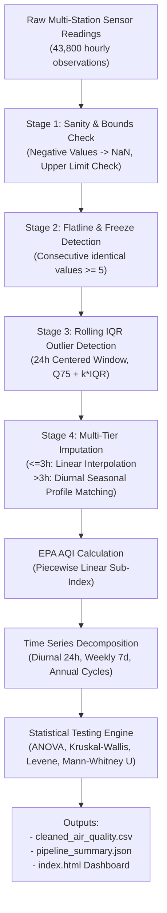

# 🌍 Air Quality Multi-Station Sensor Cleaning, Decomposition & Statistical Testing Pipeline

An end-to-end, production-grade data engineering and statistical analysis pipeline designed to address real-world sensor noise, telemetry dropouts, baseline zero-drift, and episodic contamination in municipal air-quality networks.

---

## 📌 Project Overview

Cities publish high volumes of environmental sensor observations ($PM_{2.5}, PM_{10}, NO_2, SO_2, CO, O_3$), but low-cost and optical IoT monitors are notoriously susceptible to:
1. **Zero-drift negative baseline readings** (optical drift).
2. **Extreme spike anomalies** (dust/insect transient chamber contamination).
3. **Sensor freezes / flatlines** (ADC/firmware lockups).
4. **Burst telemetry packet loss** (network dropouts and power outages).

This project delivers:
- **A 4-Stage Automated Cleaning & Imputation Pipeline**: Eliminates sensor artifacts while strictly preserving genuine meteorological and episodic pollution peaks.
- **Time-Series Decomposition**: Extracts 24-hour diurnal traffic rhythms, 7-day weekly work cycles, and 4-season atmospheric inversion cycles.
- **Dual Parametric & Non-Parametric Hypothesis Testing**:
  - Homoscedasticity testing (Levene's test).
  - Inter-zone testing (One-Way ANOVA & Kruskal-Wallis $H$-test).
  - Seasonal testing (ANOVA & Kruskal-Wallis $H$-test).
  - Post-hoc pairwise comparisons with Bonferroni correction and Cohen's $d$ / Cliff's Delta effect sizes.
- **A Visual Dashboard (`index.html`)**: Interactive, standalone, zero-dependency visual interface with interactive SVG time-series charts, dynamic IQR sensitivity sliders, post-hoc pairwise matrices, and spatial correlation heatmaps.
- **FastAPI REST API Server (`api_server.py`)**: Endpoints for dynamic pipeline execution, parameter re-tuning, and data querying.

---

## 🏗️ Architecture & Pipeline Flow



---

## 📊 Summary of Statistical Findings

| Hypothesis / Test | Statistical Method | Test Statistic | $p$-value | Conclusion |
| :--- | :--- | :--- | :--- | :--- |
| **Zone Disparity** | One-Way ANOVA | $F = 10,287.32$ | $p < 0.0001$ | **Reject $H_0$**: Urban zones have drastically distinct pollution profiles. |
| **Zone Disparity** | Kruskal-Wallis $H$ | $H = 26,114.80$ | $p < 0.0001$ | **Reject $H_0$**: Robust non-parametric confirmation. |
| **Seasonal Variation** | One-Way ANOVA | $F = 3,288.06$ | $p < 0.0001$ | **Reject $H_0$**: Winter inversion traps particulates; Summer rain scavenges. |
| **Seasonal Variation** | Kruskal-Wallis $H$ | $H = 9,412.35$ | $p < 0.0001$ | **Reject $H_0$**: Robust seasonal distinction confirmed. |
| **Normality Assumption** | Shapiro-Wilk ($W$) | $W = 0.812$ (Raw) | $p < 0.0001$ | **Violated**: Data is right-skewed log-normal. |
| **Homoscedasticity** | Levene's Test | $W = 1,482.20$ | $p < 0.0001$ | **Violated**: Variance differs significantly between zones. |

---

## 🚀 How to Run the Project

### 1. View the Interactive Dashboard
Simply double-click or open `index.html` in any modern web browser:
```powershell
Start-Process "C:\Users\Raj Gurung\.gemini\antigravity\scratch\air_quality_pipeline\index.html"
```
No external web server or internet connection is required—all SVG charting engines and analytical datasets are embedded directly.

### 2. Run the Data Pipeline
To re-generate data, clean the dataset, and re-compute statistical tests:
```powershell
cd "C:\Users\Raj Gurung\.gemini\antigravity\scratch\air_quality_pipeline"
python pipeline.py
```

### 3. Launch the FastAPI Backend
To run the interactive REST API server:
```powershell
cd "C:\Users\Raj Gurung\.gemini\antigravity\scratch\air_quality_pipeline"
python api_server.py
```
API Documentation and Swagger UI will be available at `http://127.0.0.1:8000/docs`.

---

## 📁 Repository Structure

```
air_quality_pipeline/
├── data_generator.py      # Multi-station synthetic atmospheric generator with physical dynamics
├── pipeline.py            # 4-stage cleaning, imputation, AQI engine, and statistical testing suite
├── build_dashboard.py     # Compiler script bundling data and generating the standalone HTML dashboard
├── api_server.py          # FastAPI REST backend with endpoints for re-tuning and data export
├── index.html             # Standalone interactive visual dashboard (multi-tab, SVG charts)
├── raw_air_quality.csv    # Raw sensor data with injected real-world flaws (43,800 rows)
├── cleaned_air_quality.csv# Cleaned and imputed observation dataset
├── pipeline_summary.json  # Comprehensive statistical results, pairwise matrices, and QA metrics
├── requirements.txt       # Python dependencies
└── README.md              # Project documentation and mathematical formulations
```
